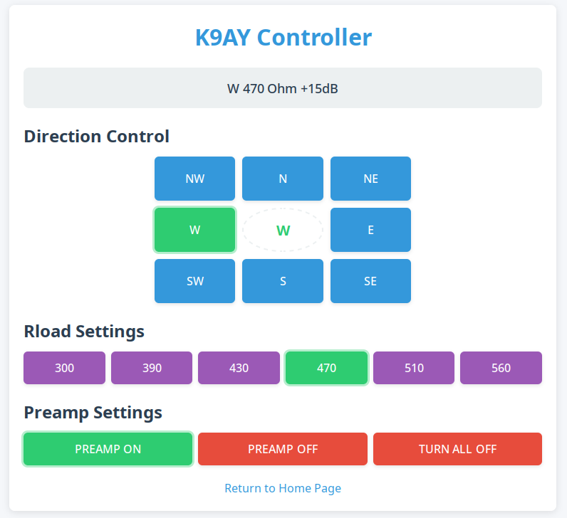
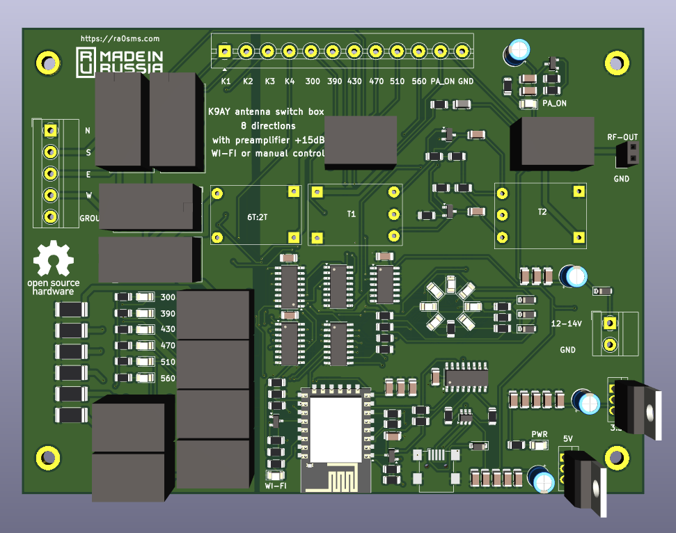

# K9AY receiving loop with Wi-Fi control

A remote switch for the K9AY receiving loop antenna. It is controlled over Wi-Fi from any web browser on a phone, tablet or PC. You can also control it from scripts and logging software through a simple HTTP API.



## Features

* **8 directions**: two loops switched by relays (N, NE, E, SE, S, SW, W, NW)
* **Switchable termination resistor (Rload)**: 300, 390, 430, 470, 510 or 560 Ohm
* **Built-in preamplifier**: +15 dB, switched on and off from the web page
* **ESP8266** controller (ESP-12 module with external Wi-Fi antenna)
* **Wi-Fi access point and client at the same time**: connect directly to the box, or through your home Wi-Fi network
* **Single power supply**: 12–13.8 V DC
* **Remembers its state**: direction, Rload and preamp are restored after a power loss
* **Custom direction names**: e.g. azimuth, "EU", "JA"
* **HTTP/JSON API** for automation
* Open hardware (KiCad) and open source firmware (Arduino IDE)

More information about the loop and construction details: https://ra0sms.com/k9ay-wifi-interface/

## Hardware

| Parameter | Value |
|---|---|
| Supply voltage | 12–13.8 V DC (power supply rated at least 500 mA) |
| Current consumption | about 250 mA |
| Loop connection | screw terminals **N S E W** |
| Radials / ground | screw terminal **GROUND** |
| Wi-Fi range | up to 50 m with an entry-level router |
| Case | 170 × 120 × 55 mm, ABS, IP68, cable glands for 3–7 mm cable |

* [Latest schematic (PDF)](KiCad/K9AY_switch/K9AY_switch.pdf)
* KiCad project, Gerbers and interactive BOM: [KiCad/K9AY_switch](KiCad/K9AY_switch/)



## Quick start

1. Power on the box. It creates a Wi-Fi access point:
   * Network name: **`K9AY_Loop_XXXXXX`**, where `XXXXXX` is the unique chip ID of the controller (it is also printed to the serial port at startup)
   * Password: **`1234567890`**
2. Connect your phone or PC to this network. Most devices open the controller page automatically (captive portal). If yours does not, open **http://192.168.4.1** in a browser.
3. To use the box through your home network, open **WiFi Configuration**. Pick your network from the list (click a row to fill in the name), enter the password and press **Connect**. Your router must have DHCP enabled.
4. Once it is connected, the green LED is on and the WLAN IP address is shown on the WiFi page. From any device in your home network, open the controller at:
   * **http://k9ay.local** (mDNS: Windows 10+, macOS, iOS, Linux; Android support depends on the browser), or
   * the IP address shown on the WiFi page (it can also be found in the router's DHCP list).

By default the access point stays on all the time, so you can always reach the box at `192.168.4.1`, even if the home network is down. It can also be disabled while the box is connected to your home network (see below).

## Web interface

| Page | Address | Description |
|---|---|---|
| Home | `/` | Connection info, uptime, firmware version, links to other pages |
| Direction Control | `/switch` | Main control page |
| WiFi Configuration | `/wifi` | Access point and WLAN status, network scan, connect to a router |
| Direction Labels | `/labels` | Rename the direction buttons |

### Direction Control

* The direction buttons are laid out as a compass rose. The selected direction is highlighted and also shown in the centre.
* **Rload**: selects the termination resistor of the loop.
* **PREAMP ON / OFF**: switches the +15 dB preamplifier.
* **TURN ALL OFF**: releases all relays, disconnects Rload and switches off the preamp.
* The status line at the top shows the current state, e.g. `NE 470 Ohm +15dB`. The page refreshes every 2 seconds, so changes made from another device or through the API appear by themselves. If the controller cannot be reached, the status line turns red.

### WiFi Configuration

* Name, status and IP address of the built-in access point
* **Disable access point while connected to WLAN**: the access point is turned off 30 seconds after the box connects to your home network. It turns back on automatically if the saved network is unavailable for 15 seconds, and it is always on after power-on until the WLAN connection is up. If you lose access, simply power-cycle the box and connect to `K9AY_Loop_XXXXXX`.
* Saved WLAN network, connection status, IP address, signal level and connection time
* List of available networks, sorted by signal level (press **Scan** to refresh)
* To make the box forget the saved network, submit the form with an empty SSID
* SSID up to 32 characters, password up to 64 characters

If the router cannot be reached (wrong password, router off), the controller retries every 60 seconds. The access point is active in the meantime.

### Direction Labels

Each of the 8 directions can be given its own name, up to 23 bytes. Cyrillic and other UTF-8 characters are supported. An empty field restores the default name. **Reset to defaults** restores all names at once.

## LED

| LED | Meaning |
|---|---|
| On | Connected to the home Wi-Fi network |
| Off | Not connected to WLAN (access point only) |

## HTTP API

The box can be controlled from scripts, logging software or home automation.

**Read state**

```
GET /api/state
```
```json
{"dir":1,"r":470,"pa":true,"labels":["N","NE","E","SE","S","SW","W","NW"]}
```

* `dir`: index into `labels` (0 = N, 1 = NE … 7 = NW), `-1` means off
* `r`: Rload in Ohm, `0` means off
* `pa`: preamp state

**Change state** (`POST`, form-encoded; parameters can be combined)

| Parameter | Values |
|---|---|
| `dir` | `N`, `NE`, `E`, `SE`, `S`, `SW`, `W`, `NW` |
| `r` | `300`, `390`, `430`, `470`, `510`, `560` |
| `pa` | `1` = on, `0` = off |
| `off` | `1` = turn everything off |

The response is the new state in the same format as `/api/state`. An invalid value returns HTTP 400.

```sh
curl -d "dir=NE&r=470&pa=1" http://k9ay.local/set
curl -d "off=1" http://k9ay.local/set
curl http://k9ay.local/api/state
```

**Other endpoints**

* `GET /api/info`: network status and uptime
* `GET /api/scan`: Wi-Fi scan results (`{"scanning":true}` while the scan is running)

## Firmware

Source: [src/Arduino/sketch_k9ay/sketch_k9ay.ino](src/Arduino/sketch_k9ay/sketch_k9ay.ino)

### Building

1. Install the [ESP8266 Arduino core](https://github.com/esp8266/Arduino) (tested with 3.1.2). No extra libraries are needed.
2. Board: **Generic ESP8266 Module**, Flash Size **4MB**.
3. Upload through a USB-UART adapter (GPIO0 to GND while resetting).

### Settings in the source code

At the top of the sketch:

| Constant | Default | Description |
|---|---|---|
| `softAP_password` | `1234567890` | Access point password (at least 8 characters) |
| `myHostname` | `k9ay` | mDNS name (`http://k9ay.local`) |
| `www_user` / `www_pass` | empty | Login for the web interface and API. If `www_user` is empty, no login is required |

### Stored data

The settings are stored in the emulated EEPROM, starting at address 128: Wi-Fi credentials, direction labels and the current switch state. The state is written 30 seconds after the last change, and only if it differs from the saved one. This keeps flash wear low. On the first start after an update from the old firmware, the Wi-Fi credentials saved by the old version are moved over automatically.

### Pinout

| ESP8266 | Function |
|---|---|
| GPIO13 / GPIO14 | 74HC595 data / clock (HSPI) |
| GPIO15 | 74HC595 latch |
| GPIO12 | 74HC595 output enable |
| GPIO4 | Preamp on/off |
| GPIO5 | Status LED |

Two chained 74HC595 shift registers drive the relays. The first one drives Rload (bits 0–5), the second one the direction relays.

## Documentation

* [Manual (EN)](docs/Manual_K9AY_en.pdf)
* [Manual (RU)](docs/Manual_K9AY_ru.pdf)

## License

MIT, see [LICENSE](LICENSE). © 2022 Anton Gavrilov RA0SMS
